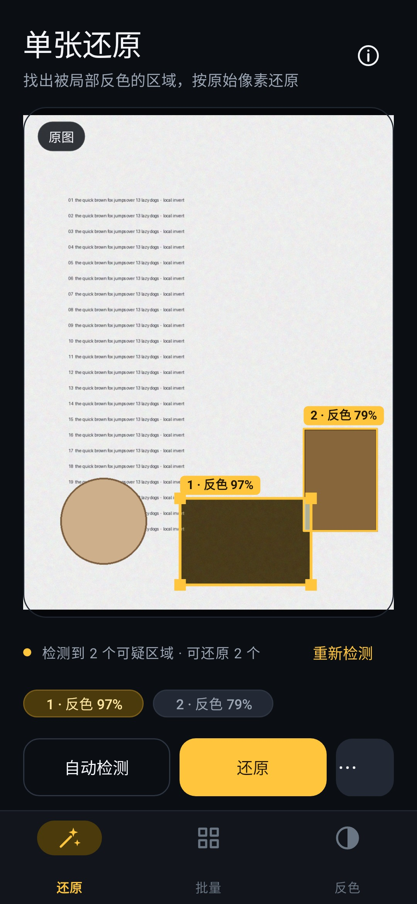
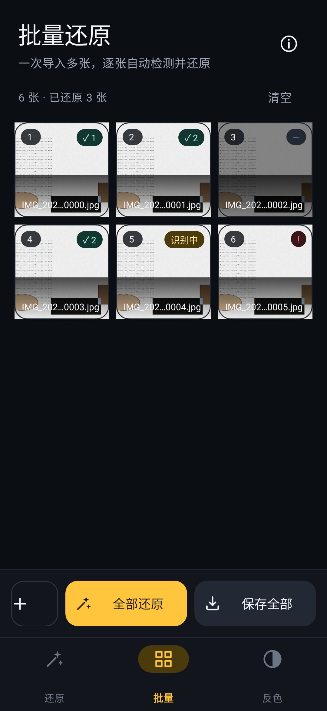
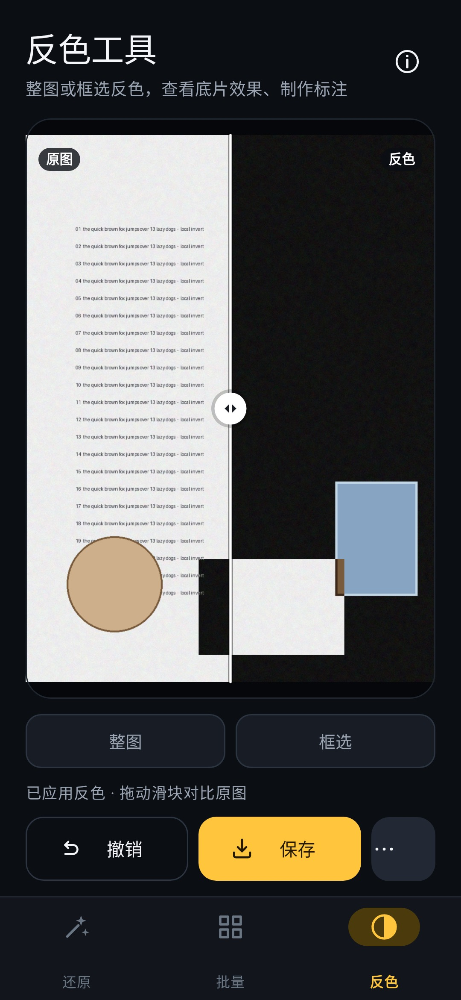

# 反色还原 · LocalInvertRestorer

一个 Android 工具，用来找出图片里被**矩形局部反色（negate / invert）**处理的区域，
把原始像素还原出来，并把判定依据（接缝落差）量化给你看。

三件事做好：**单张精修**、**多张批量还原**、**独立的整图/框选反色工具**。
所有处理都在本机完成，应用不声明网络权限。

| 单张还原 | 批量还原 | 反色工具 |
|---|---|---|
|  |  |  |

---

## 1. 它为什么能还原

反色是可逆变换：`c' = 255 - c`。它是双射，原始像素没有丢，只是显示成了“负片”。
所以还原不需要猜内容，只需要：

1. 找到被处理的矩形边界；
2. 确认这块确实是被取反的（而不是被覆盖、涂抹、模糊）；
3. 做逆运算 `c = 255 - c'`。

**只有第 2 步成立才能还原。** 模糊、马赛克、贴图覆盖、纯色填充已经真正破坏了信息，
本工具会明确标成「不可还原」，不会伪造一张看起来合理的图。

## 2. 判定原理：接缝落差

编辑边界两侧的颜色本来应该是连续的。取反会在边界制造“跳变”。对任意候选矩形：

```
内侧 band 平均色  vs  外侧 band 平均色   →  落差 cost（0..1）
```

把矩形内部按 7 种通道组合取反（R / G / B / RG / RB / GB / RGB）各算一次：

| 情况 | 原样 cost | 取反后 cost | 结论 |
|---|---|---|---|
| 真·反色块 | 大 | 骤降（通常降到 1/4 以下） | 可逆，取反即原图 |
| 覆盖 / 涂抹 | 大 | 基本不变 | 不可逆 |
| 正常内容 | 小 | — | 不是候选 |

因为反色是仿射变换，可以直接对 band 的**均值**取反；配合积分图（summed-area table）
让每次查询都是 O(1)，上千个候选矩形也能在手机上半秒内扫完。

### 候选矩形怎么来

候选由**两路**独立产生，最后按 IoU 去重：

- **通用边缘图**：高对比边界，也覆盖“贴图覆盖”这类不可逆情况；
- **反色接缝图**：逐像素算“这一侧取反后能不能接上另一侧”
  （残差小 = 接得上，落差大 = 不是平坦区），弱边也能抓到。

只靠边缘图会漏一类情况：反色块的某条边恰好压在“与自身反相后很接近”的颜色上，
这条边的原始落差可能只有 10 来个灰阶，直接掉到阈值以下，整块区域就漏检了。
反色接缝图不看绝对落差，只看“取反后是否连续”，所以这类弱边照样能出来。

拿到二值图之后：

1. 逐列/逐行提取**游程**（边缘图允许 2~3px 断裂，反色接缝图更宽，约 5~8px，
   因为穿过边界的头发、褶皱会把它切得更碎）；
2. 把起止高度大幅重叠的两条垂直游程配成左右边（按重叠比例，而不是绝对端点差；
   必须先按位置排序再配对，按长度排序会让绝大多数配对直接跳过）；
3. 验证上下边在这段跨度内也连续；
4. 对每个候选做 ±2px 的四边精修；
5. 按置信度排序，做非极大值抑制（IoU > 0.3 视为同一个）。

### 还原时的两个细节

- **色调补偿**：真实图片常是“先调色/压缩再反色”，直接取反可能残留色偏。
  用紧贴边界的**成对像素**（内侧取反值 vs 外侧原值）取逐通道**中值**偏移，
  限幅 ±15 后贴回。中值比均值抗干扰：边界外侧难免压到深色物体或高光。
- **边界精确贴回**：羽化默认关闭。纯反色的逆运算是精确的，羽化会把还原值与
  “仍然反色的原值”混合，等于在边缘留一条未还原的暗带。

## 3. 三个页面

### 单张还原

- 系统相册选图（SAF，不需要存储权限），自动检测并列出可疑区域；
- 画布支持双指缩放、双击放大、拖动；点框或点底部候选切换选中；
- **还原**只处理选中的可逆区域，可连续还原多块；
- **按住对比**立即查看原图，松手回到结果；
- 自动检测失败时，状态行右侧会变成**手动框选**；在图上拖一个矩形，松手即判定；
- 右下角「…」里还有：手动框选开关、强制 RGB 全通道、检测报告、重置、保存、分享。

### 批量还原

- 一次最多导入 30 张，三列网格逐张显示：待处理 / 识别中 / 已还原 / 无可还原 / 失败；
- 「全部还原」串行处理并显示进度，可随时停止；失败项可重试；
- 点缩略图看**前后对比**弹层，可单张保存、移除，或送到单张页继续精修；
- 「保存全部」一次写入相册，完成后可直接分享。

### 反色工具

- **整图**或**框选**反色；框选支持在预览上直接拖矩形；
- 应用后可拖动中缝滑块对比原图与结果，也可以撤销重来；
- 保存为 `原名_inverted_时间戳.png`，或直接分享。

## 4. 能力边界（请先读）

- ✅ 矩形局部反色（含只反某个通道的情况）
- ⚠️ 反色后又做了模糊 / 重压缩：能定位、能部分还原，但会有噪点
- ❌ 模糊、马赛克、纯色块、贴图覆盖：不可逆，标为「覆盖 / 涂抹」
- ❌ 非矩形（手绘笔刷状）反向涂抹：本版不做
- ⚠️ 歧义情形：深色物体恰好是周围颜色的“反相”时可能误报；先看预览再保存

## 5. 实测数据

以下数值来自 JVM 上运行的 **Kotlin 实现**（即 APK 里同一份代码）：

| 样张 | 真实区域 | 检出区域 | 误差 | 接缝落差 | 置信度 | 耗时 |
|---|---|---|---|---|---|---|
| `samples/demo_inverted.png` (900×1200) | 两块反色 | 320×210 @ (381,930) | 1px | 0.712 → 0.004 | 99% | 100ms |
| 实拍 A (1600×2400) | (537,1516)-(969,1695) | 431×176 @ (540,1519) | ≤4px | 0.290 → 0.016 | 94% | 100ms |
| 实拍 B (1600×2400) | (571,818)-(991,1242) | 420×424 @ (574,821) | ≤3px | 0.258 → 0.019 | 93% | 99ms |
| 实拍 C (1600×2400) | (757,1165)-(1229,1533) | 473×367 @ (761,1170) | ≤5px | 0.363 → 0.024 | 93% | 100ms |

耗时是桌面 JVM 数据，手机上约为 2~4 倍。

还原后边界残差：实拍 A 三边 6~13/255，实拍 B 四边 8~10/255，肉眼基本看不出接缝。
实拍 C 的右边约 30/255 —— 那条边在 JPEG 里被糊了 2px，任何硬切都会留一条淡线。

负样本（把还原结果再跑一遍检测）不产生任何反色候选（`CoreTest` 里有断言），
说明新增的反色接缝图没有把误报率抬起来。

## 6. 界面与交互

- 深色 Material 3，单一琥珀强调色；状态点、胶囊、进度条复用同一套色板；
- 底部三页签，切换不丢状态；旋转屏幕不重新解码；
- 首屏、批量页、反色页各有独立空状态插画与引导；
- 中英文两套文案（`values/`、`values-en/`），所有可见文字都走资源；
- 触感反馈只用在“点按生效”的动作上，避免滥用。

界面截图在 [`docs/screens/`](docs/screens)，由 Robolectric 用真实布局 + 真实检测结果渲染，
不是手绘稿。

## 7. 构建与安装

已编译好的调试包：**`dist/LocalInvertRestorer-debug.apk`**（6.1 MB，minSdk 24 / targetSdk 34）。
调试签名可直接安装；正式发布请自行配置 release 签名。

```bash
adb install -r dist/LocalInvertRestorer-debug.apk
```

从源码构建（Android Studio，或 JDK 17 + Android SDK 34）：

```bash
echo "sdk.dir=/path/to/Android/sdk" > local.properties
./gradlew :app:assembleDebug        # 产物 app/build/outputs/apk/debug/
```

依赖只有 AndroidX / Material / 协程，没有第三方视觉库。

### 自动化验证

```bash
# 算法层：在 JVM 上直接跑 core 源码（Bitmap 替身，无需模拟器）
cd tools/jvmtest && gradle run --args="../../samples/demo_inverted.png /tmp"

# UI + 核心回归：Robolectric（检测、批量还原、负样本、反色、界面加载）
./gradlew :app:testDebugUnitTest
```

当前 7 个用例全部通过：

- `CoreTest` ×5：双区域检测、批量还原、还原后负样本、整图反色、框选反色；
- `SmokeTest` ×1：三页签切换 + 布局加载；
- `ScreenshotTest` ×1：真实渲染 7 张界面截图。

## 8. 目录结构

```
LocalInvertRestorer/
├── app/src/main/java/com/invrestore/
│   ├── MainActivity.kt                三页签框架、返回键、状态栏 inset
│   ├── core/Model.kt                  矩形 / 候选 / 通道掩码 / 参数
│   ├── core/InversionDetector.kt      候选搜索 + 评分（积分图、游程配对、精修）
│   ├── core/Restorer.kt               取反 + 中值色调补偿 + 全分辨率逐边对齐
│   ├── core/RestorePipeline.kt        批量：一次还原所有可逆区域，重叠去重
│   ├── core/ImageOps.kt               整图 / 框选反色
│   ├── data/ImageIo.kt                解码、EXIF、缩略图、内存上限
│   ├── data/GallerySaver.kt           MediaStore 保存、FileProvider 分享
│   ├── data/MainViewModel.kt          三个页签共享的状态与任务
│   └── ui/                            三页 Fragment、画布、对比、列表、弹层
├── app/src/test/java/.../             CoreTest / SmokeTest / ScreenshotTest
├── docs/screens/                      界面截图（真实渲染）
├── tools/invrestore_ref.py            桌面参考实现（同算法，可批量跑）
├── tools/jvmtest/                     JVM 测试工程（直接复用 core 源码）
├── samples/                           合成测试图与还原结果
└── dist/                              已编译 APK
```

## 9. 已知限制与调参

参数集中在 `core/Model.kt` 的 `Tuning` 与 `tools/invrestore_ref.py` 顶部常量，两边数值一致：

| 参数 | 作用 | 调大的效果 |
|---|---|---|
| `INVERSION_GAIN` | 判定为反色所需的相对改善 | 更严格，误报少、漏报多 |
| `INVERSION_RATIO` | 取反后 cost 与原始 cost 的上限比 | 同上 |
| `EDGE_THRESHOLD` | 边缘二值化阈值 | 只保留更强的边，弱接缝会漏 |
| `SEAM_RESIDUAL` | 反色接缝图的残差上限 | 更严格，只认更像反色的边界 |
| `SEAM_MIN_STEP` | 反色接缝图的最小落差 | 调大会忽略低对比接缝 |
| `MIN_SIDE_RATIO` | 候选最小边长占比 | 忽略更小的遮挡块 |
| `BAND` | 接缝测量的带宽 | 更抗噪，但小图会失准 |

两个容易踩的点：

- **羽化默认是 0**。纯反色的逆运算是精确的，羽化会把还原值和“仍然反色的原值”
  混在一起，反而在边缘留下一圈暗带。只有反色后又做过模糊/重压缩时才建议调到 1~2。
- **检测在缩略图上做**（长边 640），映射回原图会有 1~4px 量化误差。
  所以还原前还有一步「全分辨率逐边对齐」：用真实像素把四条边各挪 ±6px。
  判据是**比值** `|内侧取反-外侧| / (|内侧-外侧|+1)`，不是绝对残差 ——
  用绝对残差会在边界外侧的平滑区失效，把边界带偏 3px，留下一列被错误取反的像素。

## 10. 隐私

- 不声明 `INTERNET`，没有任何网络代码；
- 不申请存储权限：选图走 SAF，保存走 MediaStore（Android 10+）；
- 图片只在本机内存与缓存里处理，未保存的结果会在退出后丢弃；
- 唯一的外部跳转是「关于」里的 GitHub 链接。

## 11. 使用前提

请只在你有权处理的图片上使用：自己的素材、获得授权的图片，或用于取证/审核等
合法用途。把他人刻意遮挡的内容还原并传播，可能侵犯隐私或著作权，也可能违反
平台规则与当地法律 —— 工具本身是中性的，责任在使用者。

## 12. 许可证

[MIT](LICENSE)
